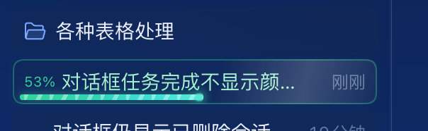

# 会话状态条 · dsh-session-bar

> 让 DeepSeek Harness 侧栏里的每一个会话自己「说话」：跑着的带进度条，跑完的亮橙色。

[](https://github.com/deepseek-ai)
[](#)
[](LICENSE)



---

## 它解决什么问题

官方侧栏的会话行只告诉你三件事：标题、一个转圈、一个相对时间（「5 分钟」）。

- 任务在后台跑的时候，你不知道它跑到哪儿了——转圈转了两分钟还是二十分钟，长得一模一样。
- 任务跑完的那一刻，界面**什么都不会发生**：转圈消失、时间变成「刚刚」，然后你就漏掉了它。官方只在「你不在主视图里看着」的会话上才标记完成，正在看的那个永远不亮。

这个插件只做一件事：**把状态画出来**。

---

## 效果

### 运行中 —— 绿色卡片 + 实时进度


- 整行转成绿色卡片（半透明绿底 + 1px 描边，和完成态是同一套骨架）。
- **行首显示估算进度百分比**（`53%`），任务一开跑就出现。
- 底部一条 **6px 高**的圆头进度条，行内专门给它留了 6px 高度，不会压到标题文字；底下一条更淡的浅绿轨道，里面青绿渐变填充，长度就是估算进度；条身上散着一层白色小点，以很慢的速度横向漂移（3.2s 走一个循环，纯装饰，不闪不跳）；末端一颗 6px 白色圆钮压在条头上，圆心正好落在进度末端，跟小滑块一样滑。
- 行本身是浅绿描边 + 10% 透明底，标题转成淡绿。
- **除了小点的缓慢漂移，没有别的循环动画**：不闪、不扫光、不呼吸、数字也不跳。安静但有生气。

### 已完成 —— 橙色卡片，一直在


- 任务跑完的瞬间，整行从绿色切成橙色：橙色描边 + 左侧橙条 + 半透明橙底 + 标题橙字，行首一颗橙色小圆点。
- **永久保留**，直到你点开这一行为止。点开即恢复原样；点行尾的「…」菜单**不算**点开，不会误清。
- 想留几个"待办"在侧栏里反复提醒自己？就这么用。

### 超时了怎么办

估算总会有跑偏的时候。一旦实际耗时超过预估，行首**不再硬撑一个假百分比**，改显示真实已用时间：

```
6:12  对话框任务完成不显示颜色…
```

光带停在末端不再前进。这时候那个数字是真实信息，不是编的。

---

## 特性

| 特性 | 说明 |
| --- | --- |
| 状态可视化 | 运行中 = 绿色卡片 + 进度条 + 百分比；已完成 = 橙色卡片 + 圆点 |
| 完成标记不丢 | 永久保留，点开才清；标题被自动改名后标记会跟着迁移 |
| 自适应估时 | 每次跑完记录真实耗时，按会话标题留最近 6 次中位数；新会话借全局中位数；都没有按 3 分钟算 |
| 超时诚实 | 超过预估就换成已用时长，不给假的 99% |
| 零配置 | 没有设置项，装上就工作 |
| 轻量动效 | 整条只有一个 3.2s 的 `background-position` 漂移（小点），其余都是 `width` 过渡；不触发重排 |
| 不拦操作 | 只画样式，不接管点击；`prefers-reduced-motion` 下动画全关 |
| 两套行都兼容 | 官方 `ui-workspace` 的行和 `dsh-session-keeper` fork 出来的行都能画 |

---

## 安装

### 手动挂载到 profile（当前唯一方式）

```bash
git clone https://github.com/machong199412345-coder/dsh-session-bar.git \
  ~/.dsh/profiles/desktop/plugins/dsh-session-bar
```

1. 在 `~/.dsh/profiles/desktop/package.json` 的 `dependencies` 里加一行：

   ```json
   "dsh-session-bar": "file:./plugins/dsh-session-bar"
   ```

2. 在 `~/.dsh/profiles/desktop/cordis.patch.yml` 里加一段：

   ```yaml
   - insert:
       - id: dsh-session-bar
         name: 'dsh-session-bar'
   ```

3. **⌘Q 完全退出**应用再打开（客户端插件在进程启动时装配，⌘R 刷新不一定够）。

---

## 配置与重置

没有设置界面，状态都存在浏览器 `localStorage` 里：

| 键 | 内容 |
| --- | --- |
| `dsh-session-bar:read` | 已点开的会话标题（橙色标记表） |
| `dsh-session-bar:durations` | 每个会话标题的耗时样本（最近 6 次） |
| `dsh-session-bar:durations:global` | 全局耗时样本（最近 24 次） |
| `dsh-session-bar:running` | 正在跑的会话的开始时间戳 |

清空这几个键就等于恢复出厂设置（估时重新学习）。

---

## 工作原理

一个纯客户端插件，不用 React、不碰服务端：

- 以 `window.__ModuleLoader__.load({ id, factory })` 的形式注入，宿主半端（`index.js`）故意留空。
- 每 500 ms 扫一遍侧栏行：`div[data-row-key^="session:"]`（官方）或 `div[role="treeitem"][class*="_sessionRow"]`（keeper fork）。
- 判断行里有没有 `[data-state="ongoing"]` 这个 spinner 锚点，就知道它在不在跑。
- 状态全靠两个 `data-*` 属性和一个 CSS 变量驱动：`data-running-mark` / `data-done-mark` / `--dsh-run-progress`。
- React 重渲染会把插件插进去的节点冲掉，所以每帧都会补回；`MutationObserver` 监听 `data-state` 变化做即时响应。

---

## 已知限制

- **百分比是估算的。** 侧栏每行能拿到的只有 `running` 和 `updatedAt` 两个字段，后台会话的步数 / 总步数 / token 进度客户端一律拿不到。所以进度是按「这个会话以前一般跑多久」推出来的，不是真实完成度。
- 会话标题是标记的 key。如果两个会话标题完全一样，它们的标记会互相干扰。
- 只支持 Web 平台（桌面端和 Web GUI 都是 Web 渲染）。

---

## 兼容性

- DeepSeek Harness `0.2.x`（DOM 锚点按 `0.2.1-rc.3` 核对）。
- 不依赖任何其它插件；和 `dsh-session-keeper` 共存（会识别它 fork 的行结构）。

---

## 更新日志

### 0.1.0
- 运行中：绿色卡片 + 行首百分比 + 底部 6px 轨道式进度条（浅绿轨道 + 渐变填充 + 白色圆钮，静态，只有长度在变）。
- 已完成：橙色卡片 + 圆点，永久保留到点开。
- 自适应估时与超时切换已用时长显示。

---

## English

**dsh-session-bar** is a client-side plugin for [DeepSeek Harness](https://github.com/deepseek-ai) that makes sidebar session rows self-describing:

- **Running** — the row turns into a green card with an estimated percentage at the leading edge and a 6px track-style progress bar (soft green track, teal gradient fill, white knob at the head, and a slow drift of tiny white dots).
- **Done** — the row flips to orange (border, left bar, dot, tinted title) and stays that way until you click the row, so finished tasks never slip by unnoticed.
- **Overtime** — past the estimate it stops pretending and shows real elapsed time (`6:12`) instead of a fake 99%.

No configuration, no server side, no looping animations. Install via the DSH plugin market, or clone into `~/.dsh/profiles/desktop/plugins/` and add the insert block to `cordis.patch.yml`.

---

## License

[MIT](LICENSE)
